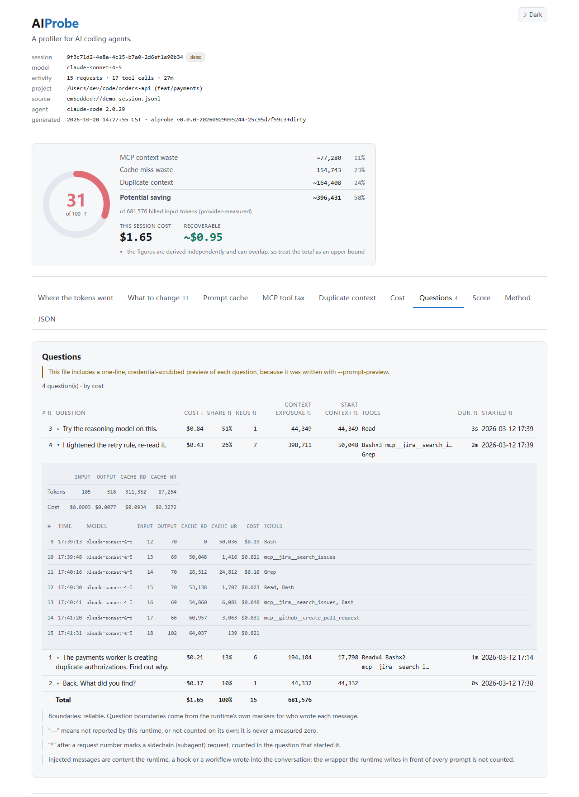
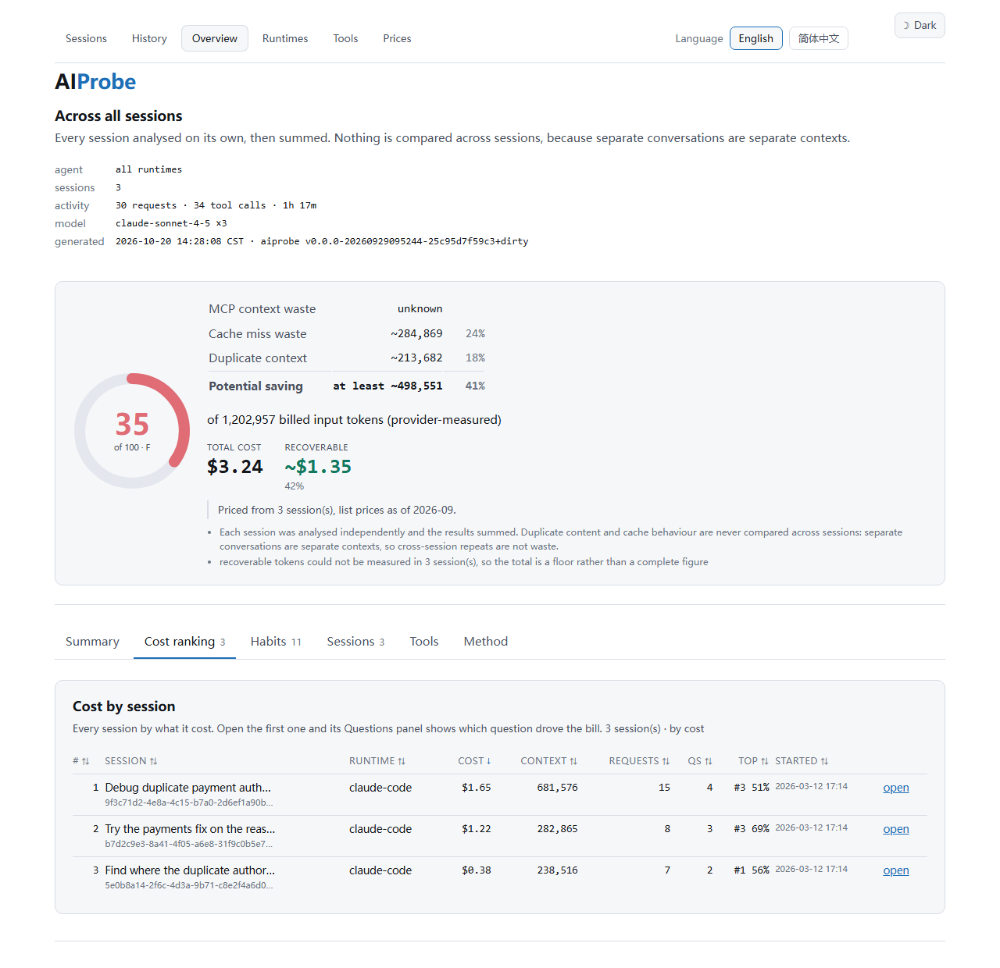

# AIProbe

> **AIProbe is an open-source profiler for AI coding agents. It finds token waste,
> cache misses, bloated MCP tools, duplicate context and inefficient tool calls.**

Claude Code, Kiro, Kiro CLI, Cursor and Codex CLI each leave a record of every
session on disk. AIProbe reads it and tells you where the tokens went, what that
cost you, and what to change — which files got read four times, which MCP tools were
loaded and never called, and what invalidated your prompt cache on turn 7.

A single Go binary. No API key, no network, no telemetry. Nothing leaves your
machine.

English | [简体中文](README.zh-CN.md)

[](https://github.com/NextProbe/aiprobe/actions/workflows/ci.yml)
[](https://pkg.go.dev/github.com/NextProbe/aiprobe)
[](https://goreportcard.com/report/github.com/NextProbe/aiprobe)
[](LICENSE)


The same session, from the terminal:

```
$ aiprobe analyze

 Context Efficiency   31/100  F   ██████░░░░░░░░░░░░░░

   MCP context waste         ~77,280    11%
   Cache miss waste          154,743    23%
   Duplicate context        ~164,408    24%
   ────────────────────────────────────────
   Potential saving         ~396,431    58%
   of 681,576 billed input tokens (provider-measured)
```

Try it in thirty seconds, on bundled synthetic data, with nothing of your own at
risk:

```sh
go install github.com/NextProbe/aiprobe@latest
aiprobe demo             # reproduces the report the screenshot above is from
aiprobe demo --html -o demo.html && open demo.html   # or the dashboard
aiprobe analyze          # then: your own most recent session
```

The complete report that `demo` prints, all eight sections, is committed at
[docs/demo-report.txt](docs/demo-report.txt). Every screenshot in this README
(including the terminal one in the [gallery](#screenshot-gallery) at the
bottom) comes from the bundled demo session — `aiprobe demo`, or `aiprobe serve`
in a sandbox holding it and two shorter sessions cut from it — so they are
reproducible with the scripts under [scripts/](scripts/), and nothing on your
machine is required.

---

## What it does

AIProbe reads an agent session transcript off your own disk and answers three
questions:

1. **Where did the tokens go?** Every prompt token the provider billed,
   attributed to system prompt, rules, MCP tool schemas, messages, file reads,
   shell output and other tool results.
2. **Why were they wasted?** Which files got read four times, which tool
   definitions were never called, and what exactly invalidated your prompt cache
   on turn 7.
3. **What should you change?** Concrete, ranked fixes with the recoverable token
   count next to each one — each with the steps to carry it out, and where an
   existing open-source tool solves the problem, a pointer to it and a way to
   measure whether it helped. See
   [the token reduction playbook](docs/playbook.md).

It also puts a price on the answer: what the session cost and what the waste in it
was worth, using rates you can [override with your own](docs/pricing.md).

It answers them for one session, or for every session at once — the second is how
you tell a habit from an incident.

It is not a token dashboard. Anything that does not help answer one of those
three questions is not in it.

Supported runtimes: **Claude Code**, **Kiro**, **Kiro CLI**, **Cursor** and
**OpenAI Codex CLI**, detected automatically from whatever you point it at.
Reports render in **English and Chinese**. Runs on macOS, Linux and Windows.

## Quickstart

```sh
# 1. install
go install github.com/NextProbe/aiprobe@latest

# 2. see it work on bundled data, with nothing of your own at risk
aiprobe demo

# 3. point it at your own most recent session
aiprobe analyze

# 4. or aggregate every session from one agent
aiprobe overview --adapter kiro --all

# 5. or browse and read reports in a local page
aiprobe serve
```

Requires Go 1.25 or newer. The only dependency is [cobra](https://github.com/spf13/cobra).

Building from source:

```sh
git clone https://github.com/NextProbe/aiprobe
cd aiprobe
make build      # ./bin/aiprobe
```

## Commands

```sh
aiprobe runtimes                   # which agents are installed, and what each reports
aiprobe runtimes --set kiro=/path  # look for a runtime's sessions somewhere else
aiprobe runtimes --unset kiro      # go back to its default location
aiprobe analyze                    # newest session for the current project
aiprobe analyze kiro               # newest session of one runtime, by name
aiprobe analyze path/to/session.jsonl
aiprobe analyze --question 3       # one question, with every request it made
aiprobe analyze --sort time        # the questions in the order they were asked
aiprobe demo                       # bundled synthetic session
aiprobe sessions                   # list transcripts on this machine
aiprobe sessions --all             # every project, not just this directory

aiprobe overview                   # every session for this project, aggregated
aiprobe overview --adapter kiro --all
aiprobe overview --all --sort cost # every session, ranked by what it cost
aiprobe overview --all --html -o all.html

aiprobe report --html              # single-file HTML dashboard
aiprobe report --json              # machine-readable report
aiprobe serve                      # local web page, pick a session and read it

aiprobe history                    # analyses already run on this machine
aiprobe history --clear            # forget all of them

aiprobe tools                      # open-source tools that reduce token spend
aiprobe pricing                    # the token prices used to turn counts into money
aiprobe pricing --init             # write an editable price file
```

### Start here: what is on this machine

```
$ aiprobe runtimes

 runtime       status          sessions  newest            what it reports
 ────────────────────────────────────────────────────────────────────────────
 claude-code   ready                 12  2026-09-17 14:02  exact tokens + cache
 kiro          ready                  2  2026-09-11 06:16  credits + cross-check
 kiro-cli      ready                  1  2026-04-03 15:33  credits + cross-check
 cursor        not installed          —  —                 requests; estimates only
 codex         not installed          —  —                 exact tokens + cache

 3 of 5 runtime(s) have sessions on this machine.
 Analyse one with:  aiprobe analyze claude-code
```

Every supported runtime is listed whether or not it is installed, because the
absence is part of the answer: if your agent is not in the list then AIProbe does
not support it yet, and if it is listed as `not installed` then it is not where
AIProbe looked — the path it checked is printed under each row.

The last column is about the format, not your sessions. A runtime recording
provider token counters gives exact numbers; one that does not gives estimates,
and every figure derived from them is marked as an estimate. See
[what the numbers mean](#what-the-numbers-mean).

The same view is in the local web interface at `/runtimes`, with the capability
breakdown per runtime and a link straight to the newest session of each.

### Pointing it at a session

Three ways, in increasing specificity:

```sh
aiprobe analyze                # newest session for the current directory
aiprobe analyze kiro           # newest session of one runtime
aiprobe analyze path/to/file   # exactly this one
```

The middle form takes any runtime name from the table above, and the obvious short
forms (`claude` for `claude-code`, `kirocli` for `kiro-cli`). A real path always
wins, so a file that happens to be named after a runtime is still read as a file.

`aiprobe sessions` lists individual sessions, so you never have to know where a
runtime stores them:

| Runtime | Where sessions live |
| --- | --- |
| Claude Code | `~/.claude/projects/<encoded-project-path>/<session-id>.jsonl` |
| Kiro | `~/.kiro/sessions/<workspace-hash>/<session-id>/messages.jsonl` |
| Kiro CLI | `~/.kiro/sessions/cli/<session-id>.jsonl` plus a `.json` sidecar |
| Cursor | `<config>/Cursor/User/globalStorage/state.vscdb`, and one per workspace under `workspaceStorage/<hash>/` |
| Codex CLI | `~/.codex/sessions/<YYYY>/<MM>/<DD>/rollout-<timestamp>-<id>.jsonl` |

Windows and Linux use the same layouts under their own base directories: `~` is
`%USERPROFILE%` on Windows, and Cursor's `<config>` is
`%APPDATA%` on Windows, `~/Library/Application Support` on macOS and `~/.config`
on Linux.

#### If your sessions are somewhere else

Those are defaults, not requirements. A store gets relocated, sessions get copied
off another machine, or an agent is installed in a way its own documentation does
not describe.

One command, no file to edit:

```sh
aiprobe runtimes                                       # where is it looking now?
aiprobe runtimes --set kiro-cli=/Volumes/work/kiro/cli # look here instead
aiprobe runtimes                                       # confirm: "(from settings)"
aiprobe runtimes --unset kiro-cli                      # go back to the default
```

`--set` validates as it goes. A relative path is refused, because it would depend on
where you happened to run the command. An unknown runtime name lists the valid ones.
A directory that does not exist yet is allowed — an unmounted volume is a real case —
but you are told, since that is the likeliest typo and the symptom otherwise is an
empty list.

Three things are consulted, most explicit first:

| Where | When it applies |
| --- | --- |
| `~/.aiprobe/paths.json` | You ran `--set`, or edited the file yourself. |
| The agent's own variable | You already set `CLAUDE_CONFIG_DIR`, `KIRO_CONFIG_DIR`, `CURSOR_CONFIG_DIR`, `CODEX_HOME` or `CODEX_SESSIONS_DIR` for the agent's benefit. AIProbe follows it without being configured. |
| The default | Everything else. |

`aiprobe runtimes` prints which of the three applied for each runtime, so a location
that is not what you expected can be traced to the thing that set it.

The settings file is plain JSON if you would rather edit it directly.
`aiprobe runtimes --init` writes one listing every runtime alongside where it
currently resolves to:

```json
{
  "defaults_when_written": {
    "kiro-cli": "/Users/dev/.kiro/sessions/cli"
  },
  "sessions": {
    "kiro-cli": "/Volumes/work/kiro/cli",
    "cursor": ""
  }
}
```

Only `sessions` is read. An empty value means "use the default", so an entry can be
disabled without deleting it, and `defaults_when_written` is a snapshot for reference
that is never read back. A file that cannot be parsed produces a warning and the
defaults still apply — a bad override should not stop an analysis, but it must not be
silent either.

Two runtimes need a word of explanation.

**Kiro CLI stores a session as two files.** The `.jsonl` holds the conversation
and the `.json` beside it holds every number worth reporting: the credit charge,
the context utilization and the model's context window. Point at either one and
both are read; if the sidecar is missing the report says which figures are gone.

**Cursor keeps every conversation in one database.** So a path alone does not
identify a session, and a conversation is addressed as `state.vscdb#<composerId>`.
`aiprobe sessions --adapter cursor` lists them with their ids. Passing just the
database analyses the largest conversation in it and tells you that is what it
did. Cursor can stay open: its store keeps recent messages in a write-ahead log,
and AIProbe reads that log alongside the database, so what you get is current
rather than stale.

Run `aiprobe <command> --help` for the full flag list. The ones worth knowing:

| Flag | Effect |
| --- | --- |
| `--lang en\|zh` | Report language. Defaults to `$LANG`, then English. |
| `--all` | On `overview` and `sessions`, cover every project rather than the current directory. |
| `--tools inventory.json` | Turns MCP schema cost from `unknown` into a measured estimate. See [below](#measuring-mcp-tool-schema-cost). |
| `--adapter auto\|claude-code\|kiro\|kiro-cli\|cursor\|codex` | Override runtime detection. |
| `--width N` | Terminal report width. Layout adapts, including for CJK glyph widths. |
| `--verbose` | Per-request detail and every note, instead of the top rows. |
| `--context-window N` | For runtimes that report utilization as a percentage rather than token counts. |
| `--no-store` | Analyse without recording anything in the local history. See [what AIProbe writes](#what-aiprobe-writes). |
| `--discount 0.3` | Fraction off list prices, so `0.3` means you pay 70%. See [what it cost](#what-it-cost). |
| `--currency EUR` | Relabel costs. No conversion is performed. |
| `--no-cost` | Omit every money figure. |
| `--sort cost\|credits\|tokens\|time` | Order of the questions table (`analyze`, `demo`, `report`) or of the session ranking (`overview`). By default credits where the runtime billed each turn (Kiro, Kiro CLI), otherwise money when there is a price, then credits, then context exposure; a ranking that mixes runtimes defaults to money. See [which question cost the most](#which-question-cost-the-most) and [which session cost the most](#which-session-cost-the-most). |
| `--question N` | On `analyze` and `demo`, print only question N, with every request in it. |
| `--prompt-preview` | On `analyze`, `demo` and `report`, include a one-line, credential-scrubbed preview of each question in `--json` and `--html` output. Off by default. |
| `--no-prompt-preview` | On `analyze` and `demo`, leave the previews out of the terminal report; on `serve`, keep them off the pages. |

### What it cost

Token counts are the accurate way to describe waste. Money is the thing that makes
anyone act on it, so the report gives both:

```
   Potential saving         ~396,431    58%
   of 681,576 billed input tokens (provider-measured)
   This session cost           $1.65
   Recoverable                ~$0.95
```

Four rates are tracked per model — uncached input, output, cache write, cache read —
because providers charge four different amounts and a cache read can cost a tenth of
an input token. A single blended price would be wrong by an order of magnitude on a
cache-heavy session, which is most of them.

```sh
aiprobe pricing              # what the rates are and where each came from
aiprobe pricing --init       # write ~/.aiprobe/pricing.json and edit it
aiprobe pricing --discount 0.3
```

Correcting a rate takes two numbers. The cache rates derive from `input`, so a model
entry is just what you would read off an invoice:

```json
{ "models": { "claude-sonnet-4-5": { "input": 3, "output": 15 } } }
```

The built-in prices are published list prices recorded at a fixed date, which is
printed next to every total. They are a starting point, not your invoice: check a
figure against a real bill before quoting it, and override anything that is wrong.

Two rules keep the numbers honest:

- **An unlisted model is approximated, and says so.** It gets a generic rate, and the
  figure is labelled with the model's name and how to correct it. What it never gets
  is a plausible-looking guess: a newer point release does not inherit an older
  generation's price, because that reported three times the real cost of a session
  during development. You can switch the generic rate off if you would rather see
  "unknown".
- **Recoverable waste is valued at what the session actually paid per prompt token**,
  not at the uncached input rate. Most recoverable context is cache-eligible, so the
  naive calculation claimed a saving larger than the entire bill.

A runtime that reports no token counters gets its cost **modelled** from the record
instead of skipped. That covers Kiro, and Kiro CLI sessions whose sidecar has no
token counts: content is charged once on the way in and read back cheaply
afterwards, and the breakdown already knows which is which, so the cache split is
derived rather than guessed:

```
   Session cost                          ~$546.76
   cache writes            1,737,898       $10.86
   cache reads         1,071,802,507      $535.90
```

That figure is a floor on the list-price cost, because cache expiry is not modelled,
and the all-uncached reading is reported as the matching ceiling. It is not the bill.
Kiro and Kiro CLI charge in credits, which are passed through untouched, and on a
long session the modelled dollars can run well above what was actually charged. The
report says so beside the figure: audit a Kiro session by its credits. Nothing is
converted into anything else.

Cursor is the one case with no figure at all. It records neither token counts nor
which model answered, so there is no rate to apply and no cost is shown — not a zero,
and not a guess.

The rates behind every figure are visible in the terminal (`aiprobe pricing`) and on
the **Prices** page of `aiprobe serve`, which also names the file to edit.

Full detail, including the file format and the arithmetic, is in
[docs/pricing.md](docs/pricing.md).

### Which question cost the most

A session total says what a conversation cost; section 6 of the report says which
question in it did. AIProbe splits the session at every message a person wrote (a
prompt, a slash command, a shell command) and gives each question the requests it
set off, up to the next one:

```
 6  QUESTIONS                                       4 question(s) · by cost
────────────────────────────────────────────────────────────────────────────
     Question                          Cost  Share Reqs Tools           Dur.
  3  Try the reasoning model o…       $0.84    51%    1 Read              3s
  4  I tightened the retry rul…       $0.43    26%    7 Bash×3 mcp…       2m
  1  The payments worker is cr…       $0.21    13%    6 Read×4 Bas…       1m
  2  Back. What did you find?         $0.17    10%    1                   0s
  ──────────────────────────────────────────────────────────────────────────
     Total                            $1.65   100%   15
```

```sh
aiprobe analyze --question 3            # that question and every request in it
aiprobe analyze --sort time --verbose   # every question in order, with its requests
```

- **The parts add up to the whole, exactly.** Every request belongs to one question
  or to a labelled bucket: *before the first question* (work a resumed session did
  before anyone typed) or *unattributed*. Per-question costs and every token class
  sum to the session's own totals, and the Total line is the session total itself.
- **Measured where the runtime measures.** Claude Code and Codex report counters per
  request, so each question is priced request by request. Kiro, and Kiro CLI
  sessions whose sidecar has no token counts, report none, so the session's
  modelled cache writes and reads are apportioned to questions by the context each
  one first sent and re-sent; see
  [docs/pricing.md](docs/pricing.md#what-each-question-cost). Credits are split by
  runtime turn where the runtime records them per turn, and shown for the session
  otherwise.
- **Ranked by what was billed.** Where the runtime charged each turn (Kiro, Kiro CLI),
  the table is ordered by credits by default: they are the bill, and a dollar figure
  beside them is AIProbe's list-price estimate, whose `~` amounts can run well above
  the charge on long sessions. Otherwise it is ordered by cost, or by context
  exposure when there is no price. The share column has the same basis (`% cred` on
  a Kiro session), and `--sort` changes the order, never what the share is a share
  of.
- **How far the split can be trusted is stated.** A *Boundaries* line says whether
  the question boundaries come from the runtime's own markers for who wrote each
  message, or why they are incomplete.
- **Previews stay out of files.** The terminal shows a scrubbed one-line preview of
  each question; `--no-prompt-preview` hides it, for a shared screen. `--json` and
  `--html` leave previews out unless you pass `--prompt-preview`, and the history
  never stores them.

The HTML report has the same table as a sortable **Questions** tab, and each row
expands to the requests behind it:



### Across all sessions

One report tells you what happened in one conversation. `aiprobe overview`
tells you what you keep doing, which is the thing worth changing:

```sh
aiprobe overview --adapter kiro --all
```

It ranks rules by recoverable tokens across every session, so a rule that fires in
most of them stands out as a habit rather than an incident. It also ranks the
sessions themselves, so you know which single report to open next.

Each session is analysed independently and the results are summed. Duplicate
content and cache behaviour are **never** compared across sessions: separate
conversations are separate contexts, so the same file read in two sessions is not
redundancy and nothing would be recovered by "fixing" it. Concatenating
transcripts would have been easier and would have invented waste.

Sums of partly unknown quantities are reported as floors (`≥`), never as totals,
so a session whose MCP cost could not be measured never reads as clean.

In the local web interface this is one click per runtime.

### Which session cost the most

The overview also ranks every session it covered by what it cost, in its section
*Cost by session*: runtime, cost, credits (for a runtime that bills in its own
units), context exposure, requests, questions, and the costliest question with the
share it took: of the session's credits on a row the runtime charged per turn (Kiro,
Kiro CLI), of its cost otherwise.

```sh
aiprobe overview --all                  # every session, costliest first
aiprobe overview --adapter kiro --all   # one runtime: Kiro sessions by credits
aiprobe overview --all --sort credits   # or by credits, tokens or time
```

Money is the default order, because it is the one unit every runtime shares. A
ranking of one runtime that bills turn by turn (Kiro, Kiro CLI) is ordered by credits
instead, since those are what it charged, so the order matches each session's own
Questions table. When Kiro or Kiro CLI rows carry a modelled `~` cost, a note under
the table says those amounts are estimates that can run well above the bill and that
the rows' credits are the charge; ordered by cost, it also suggests sorting by
credits. `--sort` changes only the order: each row's share keeps its own basis.

A row's figures are copied from that session's own analysis, so they are always the
numbers its report shows. The terminal lists the top rows (`--top N`, or all of them
with `--verbose`). `--json` writes the rows as `ranking`, beside `ranking_sort` and
`ranking_modelled`. The HTML has a **Cost ranking** tab that prints each row's path
with the `aiprobe analyze` command that audits it, and in the local web interface
the Sessions page links to the ranking and each row opens that session's Questions
panel. The ranking never carries question previews.



### The local web interface

```sh
aiprobe serve                      # http://127.0.0.1:7777
aiprobe serve --open               # and open a browser
aiprobe serve --lang zh            # start in Chinese
aiprobe serve --no-prompt-preview  # no question previews on the pages
```

Three pages, one navigation bar between them:

| Page | What it is for |
| --- | --- |
| **Sessions** | every transcript on this machine, from every runtime, with the stored cost, credits and question count of each one already analysed, a link to the cost ranking, and one-click aggregates per runtime |
| **History** | every analysis already run, one row per session, with its cost, credits and question count and a score sparkline showing whether it is improving |
| **Overview** | the cross-session aggregate, the same thing `aiprobe overview` prints, including the cost ranking of every session; each row opens that session's Questions panel |

Reports open **in the page**; the download buttons are for keeping a copy. The
language switch stays on whatever page you are reading, and there is a light and
dark theme that follows your system until you choose one.

The Sessions and History columns are read from the stored index, never computed for
the page, and a dash says why it is one: "— (earlier version)" for an analysis
stored before the per-question split existed and, on the Sessions page,
"— (older analysis)" when only an analysis of an earlier state of the file, or by
another build, is stored, and "— (not analysed)" when there is none. A cost stored
with another currency or discount than the server uses is marked `≠` rather than
compared. A report's Questions panel fills in each question's one-line preview after
the page has rendered; the previews are held in the server's memory only and never
written to a download or to the history.

A one-click aggregate fills those dashes in. It treats a stored analysis without the
per-question split as stale: it re-analyses that session once and replaces the
entry, so the ranking has every session's questions and the next aggregate reuses
the result. A report page does not re-analyse by itself: an analysis stored before
the panel existed, by a build with the same version string, shows a **Re-analyse**
button in place of the panel. `--no-cost` and `--no-store` keep their meaning here:
without prices a stored priced analysis is neither shown nor replaced, and without a
store nothing is read or written. `aiprobe overview` on the command line analyses
every session afresh and never reads or writes the history.

Analyses are [stored locally](#what-aiprobe-writes), so opening a report,
switching language and going back cost one analysis between them rather than three.
On real sessions that is the difference between ~190 ms and ~8 ms per page.

An aggregate is the one slow thing here, because it analyses every session rather
than one — roughly a second each, so a Cursor store with 38 conversations takes
about half a minute the first time. Clicking one shows its progress: how many
sessions are done, which one is being read, and an estimated time left. The work
runs on the server, so closing the page does not cancel it, and because the results
are stored, opening the same aggregate again is immediate rather than another half
minute.

It is a **local GUI, not a service**:

- It binds the loopback interface only, and **refuses** any other address. Session
  transcripts contain your prompts and file contents, so exposing them on a
  network interface for convenience is not a trade this tool offers.
- No authentication, because there is nothing to authenticate. The only reachable
  client is a process on this machine, which already has filesystem access to
  everything the server can read. A password here would be theatre.
- Loopback is reachable by every account on the machine, not only yours, and the
  previews route answers whoever asks. On a machine other people can log in to,
  run `aiprobe serve --no-prompt-preview`.
- No account, no server-side database, no outbound connection. The only state it
  keeps is the analysis history, in plain JSON you can read and delete yourself.

### The HTML report

`aiprobe report --html` writes **one self-contained file**, with the same light
and dark themes as the local page. Inline CSS,
inline JavaScript, inline SVG charts, no CDN, no web font, no analytics, no
server. Open it from the filesystem, mail it to a colleague, attach it to a
ticket. It works offline because it has to: it never had a network dependency to
lose.

It contains the same data as `--json`, laid out as a browsable dashboard with
per-turn cache charts, sortable tables and the full findings list — see the
[screenshot gallery](#screenshot-gallery) at the bottom of this README.

### Measuring MCP tool schema cost

Tool definitions are the most expensive invisible part of an agent prompt: they
sit at the front of every request and they are never written to the session
transcript. Without help, AIProbe can only tell you which tools were
*called*.

Give it an inventory and the MCP Tool Tax section becomes exact:

```sh
aiprobe analyze --tools mcp-tools.json
```

The inventory is a JSON file listing the tools each server exposes:

```json
{
  "servers": {
    "jira": {
      "tools": [
        {
          "name": "search_issues",
          "description": "Search issues with a JQL query.",
          "inputSchema": { "type": "object", "properties": { "jql": { "type": "string" } } }
        }
      ]
    }
  }
}
```

That is the shape an MCP `tools/list` response already has, so it can usually be
dumped straight from your client. AIProbe also reads server *names* from
`.mcp.json` and `~/.claude.json` automatically, which is enough to spot servers
you loaded and never used.

Without an inventory, loaded tool count, utilization and schema cost are reported
as **`unknown`**. They are never estimated from thin air.

## What the numbers mean

Every figure in a report carries its provenance, because a measured number and a
guess should never look alike:

| Marker | Meaning |
| --- | --- |
| `12,345` | **Measured.** Straight from the provider's usage counters. |
| `~12,345` | **Estimated** by AIProbe's offline tokenizer. |
| `~12,345` (inferred) | **Inferred** from local evidence, with a stated confidence. |
| `unknown` | Not determinable from local data. AIProbe declines to guess. |

Provider totals are ground truth and always win. Per-category attribution is
estimated, and where consecutive requests allow it, the estimator is calibrated
against measured prompt growth (the demo session reports `×1.00`, meaning no
correction was needed).

`System / Rules` is a **residual**: measured prompt total minus estimated visible
context. It is the part of your prompt the runtime does not write to disk — the
agent's system prompt, your rules, and tool schemas. That is why a tool inventory
improves the whole breakdown, not just the MCP section.

The two waste figures behave differently and the difference matters:

- **insert waste** — what a redundant copy cost once.
- **re-billed / billed waste** — that cost multiplied by every later request that
  had to carry it. A 6k token file re-read on turn 3 of a 40 turn session costs
  6k once and roughly 220k across the session. This is the number worth acting
  on.

### When a runtime reports no token counts

Three of the five do not. AIProbe never fakes a total: every figure is marked as an
estimate, cache metrics read `unknown` rather than zero, and any exact charge the
runtime *does* report is shown as itself rather than converted into tokens.

How much can be said varies, and the report says which case you are in:

| Runtime | What it does report | So the estimate is |
| --- | --- | --- |
| Kiro IDE | credits, and utilization as a percentage | cross-checked against a window AIProbe has to assume |
| Kiro CLI | credits, utilization, **and** the window size | cross-checked against a window the runtime states |
| Cursor | nothing at all | not checkable |

For the two Kiro variants, the utilization curve is enough to falsify a wrong model
of how the runtime manages context — it caught a 3x error during development. So
those reports include a **cross-check**: how proportionally the estimate tracks the
runtime's own accounting, and what window the two jointly imply. Both numbers are
window-independent by construction, because fitting the window to the data would
force agreement and validate nothing.

Kiro CLI adds one thing the IDE cannot. Because it states both how full the window is
and how big the window is, the context it *doesn't* write to disk becomes arithmetic:
reported utilization times reported window, minus everything the transcript accounts
for, is the system prompt and tool schemas. The report quantifies that gap instead of
implying the per-request overhead is zero.

**Cursor is the honest floor.** It records no tokens, no cache, no cost, no window and
no model, so nothing anchors an estimate and no cost can be computed at all. What
still holds is everything that describes the conversation rather than the bill: which
files were read twice, which tool results were oversized, which context repeated. A
Cursor report leads with a warning saying exactly that, so its token totals are read
as indicative and its content findings are read as findings.

## Context Efficiency Score

A 0–100 score from five components: cache efficiency, context uniqueness, MCP
tool utilization, tool output efficiency and prefix stability.

It is a deterministic formula. **No model scores your session**, and no model
picks the weights. Every formula, target and grade band is published in
[docs/scoring.md](docs/scoring.md), and a test fails the build if the code and
that document ever disagree.

Components that cannot be evaluated (no MCP servers, a single-request session)
are reported as unknown and their weight is redistributed. A session is never
marked down for data AIProbe could not observe.

## Security and privacy

AIProbe is local-first and read-only, by construction:

- **Local only.** Everything happens in one process on your machine.
- **Read only, where your work lives.** It reads session transcripts and MCP
  config files. It never writes to them, never modifies your agent configuration,
  and never launches an MCP server. What it does write, it writes in its own two
  places — see [below](#what-aiprobe-writes).
- **No network.** There is no HTTP client in the binary, and a test fails the
  build if one appears. No update check, no license check, no CDN in the HTML
  output.
- **No telemetry.** Nothing is collected, counted or phoned home.
- **Your prompts stay put.** Report files carry no prompt text, file content or
  command output by default: counts, fingerprints, file paths, tool names, session
  titles and short excerpts. The terminal and the local pages show a scrubbed
  one-line preview of each question; a file includes them only when written with
  `--prompt-preview`, and the analysis history never stores them. Session titles
  are the runtime's own, and some runtimes (Codex) title a session with the first
  line of its first message.
- **No secrets recorded.** Every excerpt passes through a credential scrubber
  before it can reach a report file, and shell commands are scrubbed at capture.
- **No API key.** No LLM is called, for analysis, scoring or recommendations.

`aiprobe serve` binds loopback only and refuses anything else.

### What AIProbe writes

Two things, both on this machine, and nothing else:

| Path | What it is | How to remove it |
| --- | --- | --- |
| whatever you pass to `-o` / `--html` / `--json` | the report you asked for | delete the file |
| `~/.aiprobe/` | the analysis history, and the price file if you asked for one | `aiprobe history --clear`, or delete the directory |

The history is why a report opens instantly the second time, and why "is my context
usage getting better?" has an answer instead of being recomputed and thrown away on
every page load. It holds:

```
~/.aiprobe/
├── index.json            one record per analysis: identity, timing, headline figures, cost row
├── analyses/<id>.json     the full report, byte-identical to aiprobe --json
└── pricing.json           your token prices, only if you ran `aiprobe pricing --init`
└── paths.json             where to look for sessions, only if you ran `aiprobe runtimes --init`
```

Each stored analysis *is* a report, so it contains exactly what the bullets above
say a report contains, and nothing more: question previews are never stored,
whatever flags a command was given. Files are written with mode `0600`, the
history is capped at 500 analyses, and re-analysing an unchanged session replaces
its entry rather than adding another.

`pricing.json` appears only if you run `aiprobe pricing --init`. It is yours to edit,
never written as a side effect of an analysis, and `--init` refuses to overwrite it.

If you would rather it kept nothing:

```sh
aiprobe analyze --no-store    # analyse, record nothing
aiprobe serve --no-store      # browse reports, record nothing
aiprobe history --clear       # delete everything already recorded
aiprobe history --path        # print the directory, so you can inspect it yourself
```

`--no-store` works on `analyze`, `report`, `overview` and `serve`. The bundled
`demo` is never recorded, because synthetic numbers have no business in a history
of your real work.

To report a vulnerability, see [SECURITY.md](SECURITY.md).

## How it works

```
session record ─▶ adapter ─▶ trace model ─▶ analyzers ─────▶ report
                   ├ claude-code           ├ context breakdown    ├ terminal
                   ├ kiro                  ├ MCP tool tax         ├ HTML
                   ├ kiro-cli              ├ duplicate detector   └ JSON
                   ├ cursor                ├ prompt cache + drift
                   └ codex                 ├ score
                                           └ rules engine (17 rules)
```

- **Adapters** tolerate undocumented, version-drifting formats. Undecodable lines
  are counted and skipped, never fatal, and the count is reported.
- **The trace model** is provider-neutral. Four more adapters have been added since
  the first and none required an analyzer change, which is the property that keeps
  them comparable. Two required the *model* to learn something: that some runtimes
  drop content after a single prompt, so it is charged once rather than carried
  forward; and that a runtime may report nothing verifiable at all, which has to be
  a stated condition rather than an invisible one.
- **Duplicate detection** is lexical: normalized fingerprints for exact repeats,
  line-shingle Jaccard similarity for near repeats. No embeddings, no model calls,
  so it runs in milliseconds and gives the same answer every time.
- **Drift attribution** compares the reconstructed prompt prefix of consecutive
  requests and names a cause with an explicit confidence, or says `unknown`.
  Guessing here would be worse than useless: the fix for an idle timeout has
  nothing in common with the fix for an edited rules file.

Deeper detail in [docs/architecture.md](docs/architecture.md)
([中文](docs/architecture.zh-CN.md)). To add support for another agent or a
language, see [CONTRIBUTING.md](CONTRIBUTING.md)
([中文](CONTRIBUTING.zh-CN.md)).

### Project layout

```
main.go                 the entry point: one import, one call, no logic
internal/cli/           the command line: analyze, overview, serve, pricing, …
internal/adapters/      per-runtime parsers: claude, kiro, kirocli, cursor, codex
internal/trace/         the provider-neutral session model
internal/tokenize/      the offline token estimator
internal/sqlitedb/      a minimal read-only SQLite reader, for Cursor's store
internal/pathutil/      path comparison that behaves the same on every platform
internal/analyzer/      context, mcp, duplicate, cache, rules, score, overview
internal/pricing/       token prices, discounts, and turning counts into money
internal/toolkit/       the external open-source tool catalogue
internal/report/        terminal, html, json renderers
internal/serve/         the local web interface
internal/store/         the local analysis history
internal/i18n/          message catalogs (en, zh)
docs/                   playbook, prices, scoring, architecture — all bilingual
```

`main.go` sits at the repository root so the install path is the module path:
`go install github.com/NextProbe/aiprobe@latest`, with no suffix to remember. It
contains a package clause, one import and one call, and a test
(`TestRootMainStaysTrivial`) keeps it that way — code in `package main` cannot be
exercised from outside itself, so anything that lands there stops being covered.
Every line worth reviewing is under `internal/`.

## Development

```sh
make build      # build ./bin/aiprobe
make test       # go test ./...
make check      # gofmt check, go vet, tests
make demo       # build and run the demo report
make demo-html  # build and open the HTML dashboard
make gen        # regenerate the synthetic demo session
```

Tests use the standard library only. The bundled demo session is generated
deterministically by `internal/demo/gen.go`, so its numbers are reproducible and
the assertions in the test suite can be exact.

Some tests exist to protect the promises in this file rather than any behaviour:
the network-free guarantee, the README staying in sync with real output, and the
published scoring document matching the code. See
[CONTRIBUTING.md](CONTRIBUTING.md).

## Status

V0.1. Five runtime adapters — Claude Code, Kiro, Kiro CLI, Cursor and Codex CLI —
terminal / HTML / JSON reports, a local web interface, costs in money, English and
Chinese throughout, on macOS, Linux and Windows.

Deliberately not included yet: AI gateway, proxy, agent framework, memory, RAG,
semantic cache, model-generated recommendations, automatic config rewriting,
hosted service, accounts, database. The scope is intentionally narrow: the tool
answers where tokens went, why they were wasted, and how to recover them.

## Documentation

Every document has a Chinese counterpart. 每份文档都有中文版。

| Document | 中文 | What it covers |
| --- | --- | --- |
| [docs/playbook.md](docs/playbook.md) | [中文](docs/playbook.zh-CN.md) | What to actually do about each finding, the open-source tools at each layer, and how to measure whether one helped. |
| [docs/pricing.md](docs/pricing.md) | [中文](docs/pricing.zh-CN.md) | Where the prices come from and how to replace them with yours. |
| [docs/scoring.md](docs/scoring.md) | [中文](docs/scoring.zh-CN.md) | Every score formula, target and grade band. |
| [docs/architecture.md](docs/architecture.md) | [中文](docs/architecture.zh-CN.md) | How a session file becomes a report. Start here to read the code. |
| [CONTRIBUTING.md](CONTRIBUTING.md) | [中文](CONTRIBUTING.zh-CN.md) | Setup, the rules enforced by tests, writing an adapter, adding a language. |
| [SECURITY.md](SECURITY.md) | [中文](SECURITY.zh-CN.md) | Threat model, every file read and written, how to report a vulnerability. |

## Contributing

Bug reports, adapters for other agents, and translations are all welcome. Start
with [CONTRIBUTING.md](CONTRIBUTING.md) ([中文](CONTRIBUTING.zh-CN.md)).

## Screenshot gallery

Every screenshot below comes from the bundled synthetic demo session —
`aiprobe demo` (terminal), `aiprobe demo --html` (dashboard), or `aiprobe serve` in
a sandbox that holds only synthetic sessions (the local web interface). Regenerate
them with `scripts/screenshots.ps1` (Windows) or `scripts/screenshots.sh`
(macOS/Linux).

### The local web interface

`aiprobe serve` opens a loopback-only page for picking a session, watching your
history, and running one-click cross-runtime aggregates. Reports open in the
page; the language switch stays on whatever page you are reading.


Every AIProbe page is bilingual — the same content is available in English and
简体中文:


### Dashboard, dark theme

The dashboard used for the hero above is shown in the light theme. The same
report renders in dark, following the reader's system preference:


### What to change

Deterministic rules over the session, each finding with the recoverable token
count, the evidence it fired on, and steps to carry out the fix.


### Prompt cache

Per-turn cache hit ratio and prefix drift attribution. The turns where the
prefix broke are labelled with a cause, not just a number.


### MCP tool tax

How many tools each server contributed to the prompt, how many were actually
called, and how many billed tokens the never-called ones cost across the
session.


### Duplicate context

Files read multiple times, shell output repeated verbatim, and tool results
returned identically — each row shows what it cost once and what it cost
across every later request that had to carry it.


### Context Efficiency Score

Five components, one 0–100 score. The formula is deterministic and published
in [docs/scoring.md](docs/scoring.md) — no model is involved.


### The terminal report

If you prefer the CLI, `aiprobe demo` prints the same eight sections without
opening a browser:


## License

MIT. See [LICENSE](LICENSE).
