# AIProbe

> **AIProbe 是一个面向 AI 编程 agent 的开源 profiler。它找出被浪费的 token、缓存未命
> 中、臃肿的 MCP 工具、重复的上下文，以及低效的工具调用。**

Claude Code、Kiro、Kiro CLI、Cursor 和 Codex CLI 都会把每个会话的记录留在磁盘上。AIProbe 读这些文
件，告诉你 token 花在了哪里、花了多少钱、以及该改什么——哪个文件被读了四遍、哪些 MCP 工
具加载了却从没被调用、第 7 轮到底是什么让你的 prompt 缓存失效了。

一个单文件 Go 二进制。不需要 API key、不联网、无遥测。没有任何东西离开你的机器。

[English](README.md) | 简体中文

[](https://github.com/NextProbe/aiprobe/actions/workflows/ci.yml)
[](https://pkg.go.dev/github.com/NextProbe/aiprobe)
[](https://goreportcard.com/report/github.com/NextProbe/aiprobe)
[](LICENSE)

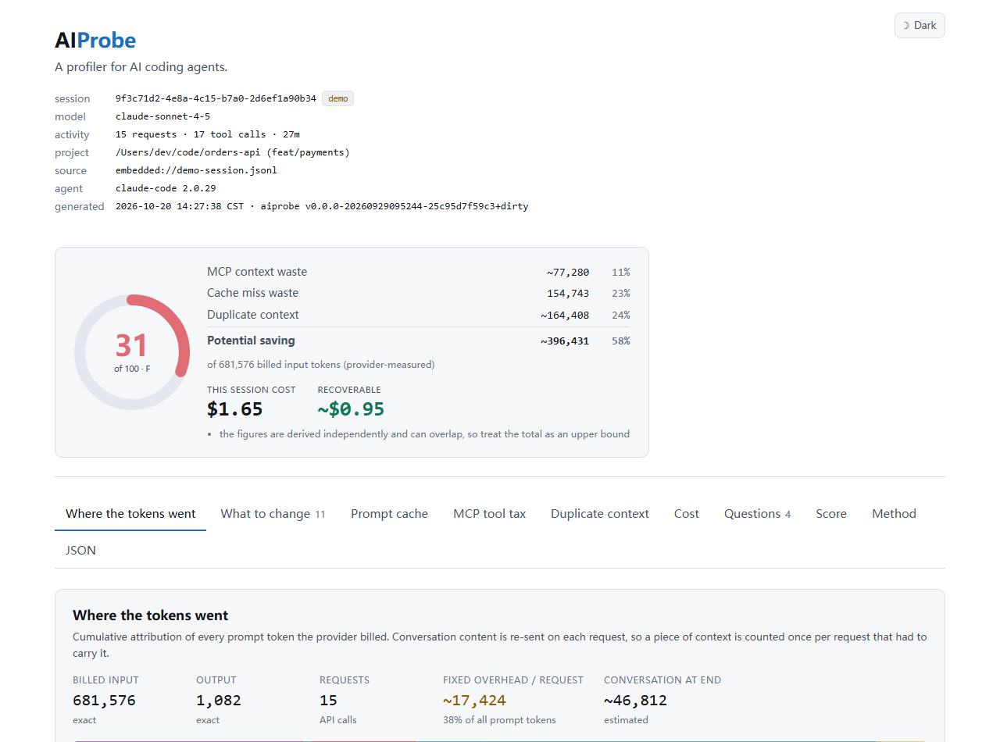

同一份会话，在终端里长这样：

```
$ aiprobe analyze --lang zh

 上下文效率   31/100  F   ██████░░░░░░░░░░░░░░

   MCP 上下文浪费          ~77,280    11%
   缓存未命中浪费          154,743    23%
   重复上下文             ~164,408    24%
   ──────────────────────────────────────
   可节省                 ~396,431    58%
   占 681,576 计费输入 token（provider 实测）
```

三十秒试一下，用的是内置合成数据，不会拿你自己的任何东西去冒险：

```sh
go install github.com/NextProbe/aiprobe@latest
aiprobe demo --lang zh                                # 复现出上面截图那份报告
aiprobe demo --html -o demo.html && start demo.html   # 或者打开 HTML dashboard
aiprobe analyze                                       # 然后：你自己最近的那个会话
```

`demo` 打印的完整报告（全部八个章节）已提交在
[docs/demo-report.txt](docs/demo-report.txt)（英文版）。本 README 里的每一张
截图（包括底部[画廊](#截图画廊)里那张终端截图）都来自内置的演示会话 ——
`aiprobe demo`，或者在只装着它和从它截出的两个较短会话的沙箱里运行的
`aiprobe serve` —— 可用 [scripts/](scripts/) 下的脚本重现，你本机不需要任何东西。

---

## 它做什么

AIProbe 读取你本机磁盘上的 agent 会话记录，回答三个问题：

1. **token 花到哪里去了？** provider 计费的每一个 prompt token，归因到系统提示、
   规则文件、MCP 工具 schema、对话消息、文件读取、命令输出和其他工具结果。
2. **为什么被浪费了？** 哪个文件被读了四遍、哪些工具定义从头到尾没被调用过，以及
   第 7 轮到底是什么东西把你的 prompt 缓存弄失效了。
3. **该改什么？** 具体的、按收益排序的改动建议，每条后面都跟着可回收的 token 数——
   并且每条都带上可直接执行的步骤；如果已经有开源工具能解决这个问题，还会给出工具
   以及验证它到底有没有用的方法。见
   [省 token 实战手册](docs/playbook.zh-CN.md)。

它还会给答案标上价格：这次会话花了多少钱，里面的浪费值多少钱。单价
[可以换成你自己的](docs/pricing.md)。

它既可以回答单个会话，也可以一次回答全部会话——后者才能区分「个例」和「习惯」。

它不是一个 token 仪表盘。凡是不能帮你回答上面三个问题的东西，都不在里面。

支持的运行时：**Claude Code**、**Kiro**、**Kiro CLI**、**Cursor** 和
**OpenAI Codex CLI**，根据你指向的东西自动识别。报告支持**中英文**。
可在 macOS、Linux 和 Windows 上运行。

## 快速开始

```sh
# 1. 安装
go install github.com/NextProbe/aiprobe@latest

# 2. 先拿内置数据看看效果，不动你自己的任何东西
aiprobe demo --lang zh

# 3. 再分析你自己最近的一次会话
aiprobe analyze --lang zh

# 4. 或者把某个 agent 的全部会话汇总起来看
aiprobe overview --adapter kiro --all --lang zh

# 5. 或者用本地网页浏览和查看报告
aiprobe serve --lang zh
```

需要 Go 1.25 或更新版本。唯一的依赖是 [cobra](https://github.com/spf13/cobra)。

从源码构建：

```sh
git clone https://github.com/NextProbe/aiprobe
cd aiprobe
make build      # 产物在 ./bin/aiprobe
```

如果不想每次都加 `--lang zh`，可以设置环境变量：

```sh
export AIPROBE_LANG=zh
```

语言的优先级是：`--lang` > `AIPROBE_LANG` > `LC_ALL` / `LC_MESSAGES` /
`LANG` > 英文。

## 命令

```sh
aiprobe runtimes                   # 装了哪些 agent，各自能上报什么
aiprobe runtimes --set kiro=/path  # 让某个运行时去别处找会话
aiprobe runtimes --unset kiro      # 回到它的默认位置
aiprobe analyze                    # 当前项目最近的一次会话
aiprobe analyze kiro               # 按名字分析某个运行时最近的一次会话
aiprobe analyze path/to/session.jsonl
aiprobe analyze --question 3       # 只看一个提问，连同它发出的每次请求
aiprobe analyze --sort time        # 按提问的先后顺序列出
aiprobe demo                       # 内置的合成会话
aiprobe sessions                   # 列出本机能找到的会话记录
aiprobe sessions --all             # 列出所有项目，而不只是当前目录

aiprobe overview                   # 当前项目全部会话的汇总
aiprobe overview --adapter kiro --all
aiprobe overview --all --sort cost # 全部会话按花费排行
aiprobe overview --all --html -o all.html

aiprobe report --html              # 单文件 HTML 报告
aiprobe report --json              # 机器可读的报告
aiprobe serve                      # 本地网页：挑会话、看报告、一键汇总

aiprobe history                    # 本机已经跑过的分析
aiprobe history --clear            # 全部忘掉

aiprobe tools                      # 能帮你省 token 的开源工具
aiprobe pricing                    # 把 token 数换算成钱时用的单价
aiprobe pricing --init             # 生成一份可以自己改的价格文件
```

### 从这里开始：本机上有什么

```
$ aiprobe runtimes

 runtime       status          sessions  newest            what it reports
 ────────────────────────────────────────────────────────────────────────────
 claude-code   ready                 12  2026-09-17 14:02  exact tokens + cache
 kiro          ready                  2  2026-09-11 06:16  credits + cross-check
 kiro-cli      ready                  1  2026-04-03 15:33  credits + cross-check
 cursor        not installed          —  —                 requests; estimates only
 codex         not installed          —  —                 exact tokens + cache

 3 of 5 runtime(s) have sessions on this machine.
 Analyse one with:  aiprobe analyze claude-code
```

无论装没装，每个受支持的运行时都会被列出来，因为「没有」也是答案的一部分：如果你的 agent
不在这个列表里，说明 AIProbe 还不支持它；如果它显示为 `not installed`，说明它不在 AIProbe
查找的位置——每一行下面都会打印它查过的路径。

最后一列说的是格式，不是你的会话。记录了 provider token 计数器的运行时能给出精确数字；没有
记录的只能给出估算，而由此推导出的每个数字都会被标记为估算。见
[这些数字是什么意思](#这些数字是什么意思)。

本地网页界面的 `/runtimes` 有同一个视图，带每个运行时的能力明细，并且可以直接跳到它最近的
一次会话。

### 怎么指定一个会话

三种方式，指定得越来越具体：

```sh
aiprobe analyze                # 当前目录最近的一次会话
aiprobe analyze kiro           # 某个运行时最近的一次会话
aiprobe analyze path/to/file   # 就这一个
```

中间那种写法接受上面表格里的任何运行时名字，以及明显的简写（`claude` 对应 `claude-code`，
`kirocli` 对应 `kiro-cli`）。真实路径永远优先，所以一个刚好和运行时同名的文件仍然会被当作
文件读取。

`aiprobe sessions` 会列出具体的会话，所以你不需要知道某个运行时把它们存在哪：

| 运行时 | 会话记录位置 |
| --- | --- |
| Claude Code | `~/.claude/projects/<编码后的项目路径>/<session-id>.jsonl` |
| Kiro | `~/.kiro/sessions/<workspace-hash>/<session-id>/messages.jsonl` |
| Kiro CLI | `~/.kiro/sessions/cli/<session-id>.jsonl`，外加一个 `.json` 边车文件 |
| Cursor | `<config>/Cursor/User/globalStorage/state.vscdb`，以及每个工作区各一个，在 `workspaceStorage/<hash>/` 下 |
| Codex CLI | `~/.codex/sessions/<YYYY>/<MM>/<DD>/rollout-<时间戳>-<id>.jsonl` |

Windows 和 Linux 用的是同样的布局，只是基准目录不同：`~` 在 Windows 上是
`%USERPROFILE%`；Cursor 的 `<config>` 在 Windows 上是 `%APPDATA%`，在 macOS 上是
`~/Library/Application Support`，在 Linux 上是 `~/.config`。

#### 如果你的会话在别的地方

上面那些是默认值，不是硬要求。存储位置会被搬走、会话会从另一台机器拷过来、agent 也可能以它
自己文档里没写的方式安装。

一条命令，不用改任何文件：

```sh
aiprobe runtimes                                       # 现在它在哪里找？
aiprobe runtimes --set kiro-cli=/Volumes/work/kiro/cli # 改成去这里找
aiprobe runtimes                                       # 确认变成了「来自你的配置」
aiprobe runtimes --unset kiro-cli                      # 回到默认位置
```

`--set` 会边设边校验。相对路径会被拒绝，因为它取决于你在哪里执行命令。运行时名字写错会列出
正确的那些。指向一个还不存在的目录是允许的——一个没挂载的卷是真实场景——但它会告诉你，因为这
是最可能的笔误，而它的症状只是一个空列表。

AIProbe 会依次查三处，越靠前越优先：

| 位置 | 什么时候生效 |
| --- | --- |
| `~/.aiprobe/paths.json` | 你用过 `--set`，或者自己改了这个文件。 |
| agent 自己的环境变量 | 你已经为 agent 本身设了 `CLAUDE_CONFIG_DIR`、`KIRO_CONFIG_DIR`、`CURSOR_CONFIG_DIR`、`CODEX_HOME` 或 `CODEX_SESSIONS_DIR`。AIProbe 会直接跟随，不需要另外配置。 |
| 默认位置 | 其余所有情况。 |

`aiprobe runtimes` 会打印每个运行时最终用的是三者中的哪一个，所以一个不符合预期的位置可以被
追溯到是什么设定了它。

如果你更愿意直接编辑，这个配置文件就是普通 JSON。`aiprobe runtimes --init` 会写一份，把每个
运行时和它当前解析到的路径并排列出来：

```json
{
  "defaults_when_written": {
    "kiro-cli": "/Users/dev/.kiro/sessions/cli"
  },
  "sessions": {
    "kiro-cli": "/Volumes/work/kiro/cli",
    "cursor": ""
  }
}
```

只有 `sessions` 会被读取。值为空表示「用默认位置」，所以一个条目可以被停用而不必删掉；而
`defaults_when_written` 只是一份供参考的快照，永远不会被读回。文件解析不了时会给出警告，同时
默认位置继续生效——一个错误的覆盖不该让分析停下来，但也不能悄无声息。

有两个运行时需要额外说明。

**Kiro CLI 把一个会话存成两个文件。** `.jsonl` 装对话，旁边的 `.json` 装所有值得报告的数
字：credit 扣费、上下文利用率、以及模型的上下文窗口。指向任意一个，两个都会被读取；如果
边车文件不在，报告会说明哪些数字因此缺失。

**Cursor 把所有对话都放在同一个数据库里。** 所以单靠一个路径无法定位一个会话，一段对话要
用 `state.vscdb#<composerId>` 来指定。`aiprobe sessions --adapter cursor` 会把它们连 id
一起列出来。只传数据库时，它会分析其中最大的那段对话，并告诉你它就是这么做的。Cursor 可
以一直开着：它的存储会把最近的消息留在预写日志里，而 AIProbe 会连同那个日志一起读，所以
你拿到的是当前状态，不是过期数据。

完整的参数列表用 `aiprobe <命令> --help` 查看。值得知道的几个：

| 参数 | 作用 |
| --- | --- |
| `--lang en\|zh` | 报告语言。默认跟随 `$LANG`，再回退到英文。 |
| `--all` | 用在 `overview` 和 `sessions` 上：覆盖所有项目，而不只是当前目录。 |
| `--tools inventory.json` | 把 MCP schema 成本从 `unknown` 变成可估算。见[下文](#测量-mcp-工具-schema-成本)。 |
| `--adapter auto\|claude-code\|kiro\|kiro-cli\|cursor\|codex` | 手动指定运行时，不走自动识别。 |
| `--width N` | 终端报告宽度。布局会自适应，包括 CJK 字符的双倍宽度。 |
| `--verbose` | 显示每次请求的明细和全部说明，而不只是前几行。 |
| `--context-window N` | 用于那些只上报利用率百分比、不上报 token 数的运行时。 |
| `--no-store` | 只分析，不往本地历史里记任何东西。见[AIProbe 会写什么](#aiprobe-会写什么)。 |
| `--discount 0.3` | 相对标价打掉的比例，`0.3` 表示按 7 折付费。见[花了多少钱](#花了多少钱)。 |
| `--currency CNY` | 只换货币标签，不做任何汇率换算。 |
| `--no-cost` | 不显示任何金额。 |
| `--sort cost\|credits\|tokens\|time` | 提问表（`analyze`、`demo`、`report`）或会话排行（`overview`）的排序。默认：运行时逐轮计费时（Kiro、Kiro CLI）按积分，否则有价格时按金额，再否则按积分，最后按上下文暴露；跨运行时的排行默认按金额。见[哪个提问最贵](#哪个提问最贵)与[哪个会话最贵](#哪个会话最贵)。 |
| `--question N` | 用在 `analyze` 和 `demo` 上：只输出第 N 个提问及其全部请求。 |
| `--prompt-preview` | 用在 `analyze`、`demo` 和 `report` 上：在 `--json` 与 `--html` 输出中附上每个提问的单行脱敏预览。默认不附。 |
| `--no-prompt-preview` | 用在 `analyze` 和 `demo` 上：终端报告不显示预览；用在 `serve` 上：页面不取也不显示预览。 |

### 花了多少钱

要准确描述浪费，token 数才是对的单位。但真正让人愿意动手改的是钱，所以报告里两个
都给：

```
   可节省                   ~396,431    58%
   占 681,576 计费输入 token（provider 实测）
   本次花费                   $1.65
   可省回                    ~$0.95
```

每个模型跟踪四种费率——未缓存输入、输出、缓存写入、缓存读取——因为 provider 确实
按四种价格收费，而一次缓存读取可能只要输入 token 的十分之一。混成一个平均单价，
在缓存占大头的会话上会差一个数量级，而绝大多数会话都是这种。

```sh
aiprobe pricing              # 看单价是多少、每条从哪来
aiprobe pricing --init       # 生成 ~/.aiprobe/pricing.json，然后自己改
aiprobe pricing --discount 0.3
```

改一个单价只需要填两个数。缓存费率由 `input` 推导，所以一条模型配置就是你从账单上
抄下来的东西：

```json
{ "models": { "claude-sonnet-4-5": { "input": 3, "output": 15 } } }
```

内置单价是某个固定日期的公开标价，这个日期会打印在每个总额旁边。它只是起点，不是
你的账单：把数字报出去之前，先和真实账单核对一遍，不对的就覆盖掉。

两条规则保证这些数字是诚实的：

- **没有列出的模型按通用单价算，并且明确标注。** 数字会带上模型名和改法。它绝不会
  给出一个「看起来像知道」的猜测：新的小版本不会继承老一代的价格——开发过程中正是
  这种继承把一个真实会话的花费报成了三倍。如果你更想看到「未知」，可以把通用单价
  关掉。
- **可省回的部分按会话实际支付的每 prompt token 单价计价**，而不是按未缓存输入的
  标价。可回收的上下文大多是可缓存的，按标价算出来的「节省」会比整张账单还多。

不上报 token 计数的运行时不会被跳过，而是从转录文件**推导**出花费，包括 Kiro，以及
sidecar 中没有 token 计数的 Kiro CLI 会话。内容进入上下文时按写入计费一次，之后每次
重发都按便宜的读取计费，而这个划分分析器本来就算得出来，所以是推导而不是猜：

```
   本次花费                               ~$546.76
   缓存写入                  1,737,898      $10.86
   缓存读取              1,071,802,507     $535.90
```

这个数字是标价成本的下限，因为缓存过期没有算进去；完全不缓存的那个读数会作为对应的
上限一并给出。它不是账单。Kiro 与 Kiro CLI 按积分计费，积分原样列出；长会话中，建模
出的美元可能明显高于实际计费。报告会在这个数字旁边写明这一点：审核 Kiro 会话请以积分
为准。任何数字都不会被换算成另一种。

所有数字背后的单价，终端里用 `aiprobe pricing` 看，网页里在 `aiprobe serve` 的
**单价**页，那里也会写明要编辑哪个文件。

完整细节，包括文件格式和具体算法，见 [docs/pricing.md](docs/pricing.md)。

### 哪个提问最贵

会话总额说明这段对话花了多少钱；报告第 6 节说明是其中哪个提问花的。AIProbe 在每一条
由人写的消息处切开会话（用户提问、斜杠命令、shell 命令），每个提问拿到它引发的请求，
直到下一个提问为止：

```
 6  提问消耗                                          4 个提问 · 按花费排序
────────────────────────────────────────────────────────────────────────────
     提问                              花费   占比 请求 工具            时长
  3  Try the reasoning model o…       $0.84    51%    1 Read              3s
  4  I tightened the retry rul…       $0.43    26%    7 Bash×3 mcp…       2m
  1  The payments worker is cr…       $0.21    13%    6 Read×4 Bas…       1m
  2  Back. What did you find?         $0.17    10%    1                   0s
  ──────────────────────────────────────────────────────────────────────────
     合计                             $1.65   100%   15
```

```sh
aiprobe analyze --question 3 --lang zh            # 这个提问以及它的每次请求
aiprobe analyze --sort time --verbose --lang zh   # 按顺序列出全部提问及其请求
```

- **各部分之和严格等于整体。** 每个请求恰好属于一个提问，或者一个有名字的桶：
  *首个提问之前*（续接的会话在有人输入之前做的工作）或*未归属*。各提问的花费与每一类
  token 之和都等于会话自己的总额，「合计」一行显示的就是会话总额本身。
- **运行时实测的地方就用实测值。** Claude Code 与 Codex 逐请求上报计数，所以每个提问
  逐请求计价。Kiro，以及 sidecar 中没有 token 计数的 Kiro CLI 会话，不上报计数：会话的
  建模缓存写入与读取按每个提问首次发送和重发的上下文分摊到各提问，见
  [docs/pricing.zh-CN.md](docs/pricing.zh-CN.md#每个提问花了多少)。运行时逐轮记录积分时
  按运行时轮次拆分积分，否则只在会话层显示。
- **按实际计费排序。** 运行时逐轮计费时（Kiro、Kiro CLI），表格默认按积分排序：积分才是
  账单，旁边的美元是 AIProbe 按标价做的估算，长会话中带 `~` 的金额可能明显高于实际计费。
  其余情况按花费排序，没有价格时按上下文暴露。占比列用同一口径（Kiro 会话上是「占积分」），
  `--sort` 只改顺序，不改占比的口径。
- **切分有多可信会写出来。** 「边界」一行说明提问边界是否取自运行时自己对每条消息作者
  的标记，或者为什么不完整。
- **预览不进文件。** 终端为每个提问显示一行脱敏预览；`--no-prompt-preview` 可以关掉，
  适合共享屏幕时用。`--json` 与 `--html` 默认不含预览，除非加 `--prompt-preview`；
  历史存储永远不保存预览。

HTML 报告里是同一张表，在可排序的**提问**标签页中，每一行都能展开到它背后的请求：

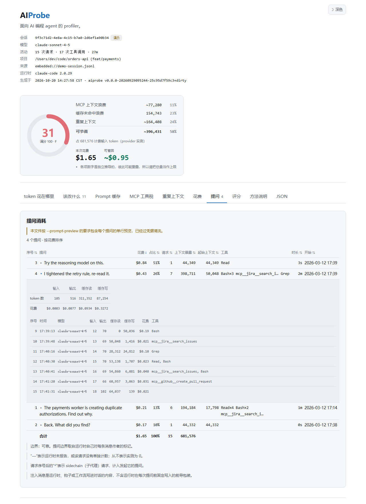

### 跨会话汇总

单会话报告告诉你「这一次对话发生了什么」。`aiprobe overview` 告诉你「你反复
在做什么」，后者才是真正值得改的东西：

```sh
aiprobe overview --adapter kiro --all --lang zh
```

它按全部会话的可回收 token 给规则排序，所以在大多数会话里都触发的规则会凸显出来
——那是习惯，不是个例。它同时也给会话本身排序，让你知道接下来该打开哪一份单会话
报告。

每个会话都是独立分析后再求和的。重复内容与缓存行为**从不**跨会话比较：不同对话是
不同的上下文，所以同一个文件在两个会话里各读一次不算冗余，也没有任何东西可以通过
「修掉它」来回收。直接把会话记录拼起来会更简单，但那会凭空造出浪费。

部分未知的求和一律报告为下限（`≥`），而不是总量，这样某个无法测量 MCP 成本的会话
就不会被读成「很干净」。

在本地网页界面里，这件事是每个运行时一个按钮。

### 哪个会话最贵

汇总报告还会在「会话消耗排行」一节列出它覆盖的每个会话的消耗：运行时、花费、积分（以自有
单位计费的运行时）、上下文暴露、请求数、提问数，以及最贵的那个提问和它的占比——运行时逐轮
计费的行（Kiro、Kiro CLI）是占该会话积分的比例，其他行是占花费的比例。

```sh
aiprobe overview --all --lang zh                  # 全部会话，最贵的在前
aiprobe overview --adapter kiro --all --lang zh   # 单个运行时：Kiro 会话按积分排序
aiprobe overview --all --sort credits --lang zh   # 或按积分、token、时间排序
```

默认按金额排序，因为金额是所有运行时共有的唯一单位。只含一个逐轮计费运行时（Kiro、
Kiro CLI）的排行改按积分排序，因为积分才是它实际收取的费用，这样顺序与每个会话自己的
提问表一致。Kiro 或 Kiro CLI 行带有建模的 `~` 花费时，表格下方会说明这些金额是估算、
可能明显高于实际计费，这些行的积分才是实际计费；按花费排序时还会提示改按积分排序。
`--sort` 只改顺序：每一行的占比保持各自的口径。

每一行的数字都复制自该会话自己的分析，所以总是和它的报告一致。终端列出排在前面的几行
（`--top N`，或用 `--verbose` 列出全部）。`--json` 把这些行写成 `ranking`，旁边是
`ranking_sort` 与 `ranking_modelled`。HTML 里有**消耗排行**标签页，每一行都列出它的路径
和审计它的 `aiprobe analyze` 命令；本地网页界面里，会话列表页有到排行的入口，每一行都
直接打开该会话的提问面板。排行永远不含提问预览。

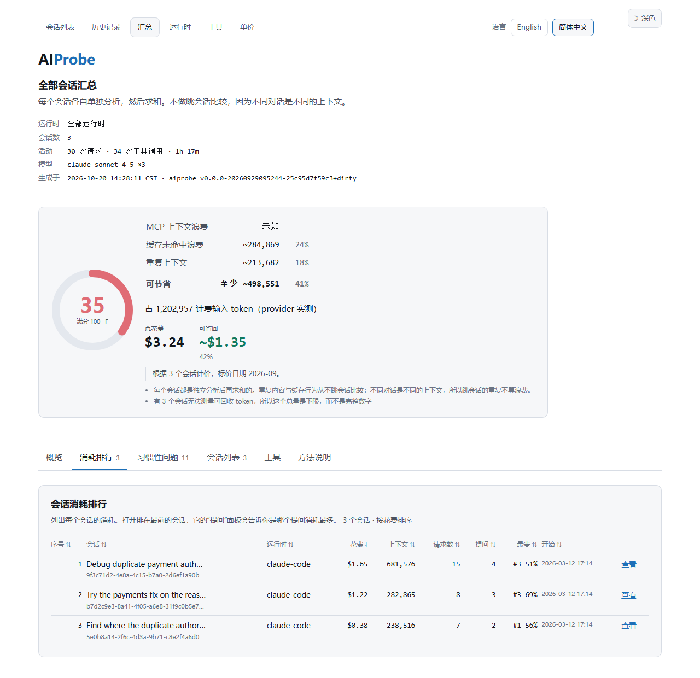

### 本地网页界面

```sh
aiprobe serve                      # http://127.0.0.1:7777
aiprobe serve --open               # 同时打开浏览器
aiprobe serve --lang zh            # 以中文启动
aiprobe serve --no-prompt-preview  # 页面上不显示提问预览
```

三个页面，之间有一条导航栏：

| 页面 | 用来干什么 |
| --- | --- |
| **会话列表** | 本机所有运行时的全部会话记录，已分析的会话带存储的花费、积分与提问数，有到消耗排行的入口，每个运行时带一键汇总 |
| **历史记录** | 已经跑过的每次分析，一行一个会话，带花费、积分、提问数和评分趋势小图，直接看出在变好还是变差 |
| **汇总** | 跨会话汇总，和 `aiprobe overview` 打印的是同一份东西，包括全部会话的消耗排行；每一行都直接打开该会话的提问面板 |

报告是**在页面里打开**的；下载按钮只是用来存副本。切换语言不会把你从当前页面弹走。
另外有浅色/深色主题，默认跟随系统，你也可以自己选。

会话列表与历史记录里的这几列读自存储索引，从不为页面临时计算，而且「—」会说明原因：
在按提问拆分出现之前存下的分析显示「—（早期版本）」；会话列表页上，只存有该文件早先
状态或其他构建的分析时显示「—（旧分析）」，完全没有存档时显示「—（未分析）」。以与本
服务不同的币种或折扣存储的花费标 `≠`，不直接比较。报告页的提问面板在页面渲染之后再填入
每个提问的单行预览；预览只在服务进程内存中，从不写入下载文件或历史。

一键汇总会把这些「—」补上。它把没有按提问拆分的存档视为过期：对该会话重新分析一次并
替换原条目，这样排行里每个会话都有提问数据，下一次汇总直接复用结果。报告页不会自行重新
分析：版本号相同、但在提问面板出现之前存下的分析，会在面板的位置显示**重新分析**按钮。
`--no-cost` 与 `--no-store` 在这里也保持原意：不带价格时，带价格的存档既不显示也不被
替换；不用存储时什么都不读也不写。命令行的 `aiprobe overview` 每次都重新分析每个会话，
从不读写历史。

分析结果会[存在本地](#aiprobe-会写什么)，所以「打开报告 → 切语言 → 返回」这一
串操作总共只算一次分析，而不是三次。在真实会话上，这是每个页面 ~190ms 和 ~8ms 的
区别。

汇总是这里唯一慢的东西，因为它要分析每一个会话而不是一个 —— 大约一个会话一秒，所以
一个有 38 段对话的 Cursor 存储第一次要跑半分钟左右。点进去会看到进度：做完了几个、
正在读哪一个、以及预计还要多久。活儿跑在服务端，所以关掉页面不会取消它；而且因为结果
会被存下来，再打开同一份汇总是立刻出来的，不用再等半分钟。

它是一个 **本地 GUI，不是服务**：

- 只绑定回环地址，**拒绝**任何其他地址。会话记录里包含你的 prompt 和文件内容，为了
  方便就把它们暴露到网络接口上，这个交换本工具不提供。
- 没有认证，因为没有东西需要认证。唯一能访问它的客户端是本机上的进程，而它本来就
  有权限读取服务端能读的所有文件。在这里加密码只是安慰剂。
- 回环端口对这台机器上的每个账户都可达，不只是你自己，预览路由也不区分来访者。在
  别人也能登录的机器上，请使用 `aiprobe serve --no-prompt-preview`。
- 没有账号、没有服务端数据库、也没有任何对外连接。它唯一保留的状态就是分析历史，
  以纯 JSON 存放，你自己就能读、也能删。

### HTML 报告

`aiprobe report --html` 写出的是**一个自包含的文件**，并且和本地页面一样支持浅色/
深色主题：CSS 内联、JavaScript
内联、SVG 图表内联，没有 CDN、没有外部字体、没有统计代码、没有服务端。可以直接从
文件系统打开、邮件发给同事、附在工单上。它能离线工作，因为它从来就没有过网络依赖
可以失去。

内容和 `--json` 完全一致，只是排成了可浏览的仪表盘：每轮的缓存曲线图、可排序的表格
和完整的发现列表 —— 参见 README 底部的[截图画廊](#截图画廊)。

### 测量 MCP 工具 schema 成本

工具定义是 agent prompt 里最贵的隐形部分：它们位于每次请求的最前面，而且从来不会被
写进会话记录。没有额外信息时，AIProbe 只能告诉你哪些工具**被调用过**。

给它一份工具清单，MCP 工具税这一节就变精确了：

```sh
aiprobe analyze --tools mcp-tools.json
```

清单是一个 JSON 文件，列出每个服务器暴露的工具：

```json
{
  "servers": {
    "jira": {
      "tools": [
        {
          "name": "search_issues",
          "description": "Search issues with a JQL query.",
          "inputSchema": { "type": "object", "properties": { "jql": { "type": "string" } } }
        }
      ]
    }
  }
}
```

这正是 MCP `tools/list` 响应本来的结构，所以通常可以直接从客户端里导出来。
AIProbe 还会自动从 `.mcp.json` 和 `~/.claude.json` 读取服务器**名字**，这已经
足够发现那些你加载了却从没用过的服务器。

没有清单时，已加载工具数、利用率和 schema 成本都报告为 **`unknown`**。它们绝不会被
凭空估算出来。

## 这些数字是什么意思

报告里每个数字都带着它的来源，因为实测值和猜测值绝不应该长得一样：

| 标记 | 含义 |
| --- | --- |
| `12,345` | **实测。** 直接来自 provider 的 usage 计数。 |
| `~12,345` | AIProbe 用离线 tokenizer **估算**的。 |
| `~12,345`（推导） | 由本地证据**推导**得出，并附带明确的置信度。 |
| `unknown` | 从本地数据无法确定。AIProbe 拒绝猜。 |

provider 的总量是基准真值，永远优先。按类别的归因是估算值；在连续请求允许的情况
下，估算器会用实测的 prompt 增量做校准（演示会话报告 `×1.00`，说明不需要修正）。

`系统提示 / 规则` 是一个**残差**：实测 prompt 总量减去估算的可见上下文。它就是运行时
不写到磁盘上的那部分 prompt —— agent 的系统提示、你的规则文件，以及工具 schema。这
也是为什么一份工具清单能改善整个拆分，而不只是 MCP 那一节。

两个浪费数字的含义不同，这个区别很重要：

- **一次性插入浪费** —— 一份冗余副本当时花掉的成本。
- **重复计费浪费** —— 上面那个成本乘以后续每一次不得不携带它的请求。一个 6k token
  的文件在 40 轮会话的第 3 轮被重读，一次是 6k，整个会话大约是 220k。**这才是值得
  动手的数字。**

### 当运行时不上报 token 数时

五个运行时里有三个不上报。AIProbe 绝不伪造总量：所有数字都标成估算值，缓存指标报告为
`unknown` 而不是 0，运行时**确实**上报的任何精确计费都按它本来的单位列出，而不是换算成
token。

能说到什么程度是有差别的，报告会说明你属于哪种情况：

| 运行时 | 它上报什么 | 于是估算值 |
| --- | --- | --- |
| Kiro IDE | credit，以及百分比形式的利用率 | 对着一个 AIProbe 必须假设的窗口做交叉校验 |
| Kiro CLI | credit、利用率，**外加**窗口大小 | 对着一个运行时明确给出的窗口做交叉校验 |
| Cursor | 什么都不报 | 无法校验 |

对两个 Kiro 变体来说，利用率曲线足以推翻一个错误的上下文模型——开发过程中它抓出过一个
3 倍的错误。所以这两种报告里包含一个**交叉校验**：估算值与运行时自己的记账有多成比例，
以及两者共同推出的窗口是多大。这两个数字在构造上都与窗口无关，因为把窗口拟合到数据上会
强行造出一致性，什么也验证不了。

Kiro CLI 比 IDE 多出一样东西。因为它同时给出了窗口有多满和窗口有多大，那些它**没有**写到
磁盘上的上下文就变成了算术：上报的利用率乘上报的窗口，减去转录文件能解释的一切，差额就是
系统提示和工具 schema。报告会把这个差额量化出来，而不是暗示每次请求的固定开销是零。

**Cursor 是诚实的下限。** 它不记录 token、不记录缓存、不记录花费、不记录窗口、也不记录模
型，所以没有任何东西能锚定估算，花费根本无法计算。仍然成立的是一切描述对话而非账单的东
西：哪些文件被读了两次、哪些工具结果过大、哪些上下文在重复。一份 Cursor 报告会用一条警告
开门见山地说明这一点，这样它的 token 总数会被当作参考值来读，而它的内容层面发现会被当作
真正的发现来读。

## 上下文效率评分

0–100 的评分，由五个分量构成：缓存效率、上下文唯一性、MCP 工具利用率、工具输出效率
和前缀稳定性。

它是一个确定性公式。**没有任何模型给你的会话打分**，也没有模型来选权重。每一个公式、
目标值和等级区间都公布在 [docs/scoring.md](docs/scoring.md)，并且有测试保证：代码和
这份文档一旦不一致，构建就失败。

无法评估的分量（没有 MCP 服务器、只有一次请求的会话）报告为 unknown，其权重按比例
重新分配。会话绝不会因为 AIProbe 观测不到的数据而被扣分。

## 安全与隐私

AIProbe 在设计上就是 local-first、只读的：

- **仅本地。** 一切都在你机器上的一个进程里发生。
- **对你的东西只读。** 它读取会话记录和 MCP 配置文件，从不写入它们、从不修改你的
  agent 配置、也从不启动 MCP 服务器。它确实会写的东西只有两处，都在自己的地方，
  见[下文](#aiprobe-会写什么)。
- **不联网。** 二进制里没有 HTTP 客户端，而且有测试保证：一旦出现就构建失败。没有
  更新检查、没有 license 校验，HTML 输出里也没有 CDN。
- **无遥测。** 不采集、不统计、不回传任何东西。
- **你的 prompt 留在原地。** 报告文件默认不写入 prompt 文本、文件内容或命令输出，
  只有计数、指纹、文件路径、工具名、会话标题和简短摘录。终端与本机页面显示每个提问的
  单行脱敏预览；只有用 `--prompt-preview` 写出的文件才包含预览，历史存储永远不保存
  预览。会话标题沿用运行时自己的标题，个别运行时（如 Codex）以首条消息的首行作标题。
- **不记录密钥。** 每一段摘录在进入报告文件之前都要过一遍凭据擦除器，shell 命令在
  采集时就已经擦除。
- **不需要 API key。** 分析、评分和建议都不调用任何 LLM。

`aiprobe serve` 只绑定回环地址，其他地址一律拒绝。

### AIProbe 会写什么

两样东西，都在本机，除此之外没有别的：

| 路径 | 是什么 | 怎么删 |
| --- | --- | --- |
| 你用 `-o` / `--html` / `--json` 指定的路径 | 你主动要求生成的报告 | 删掉那个文件 |
| `~/.aiprobe/` | 分析历史，以及你主动生成的价格文件 | `aiprobe history --clear`，或者直接删目录 |

有了历史，第二次打开报告才是瞬时的，「我的上下文用得越来越好了吗」才有答案，而不是
每次翻页都重算一遍再扔掉。里面是：

```
~/.aiprobe/
├── index.json            每次分析一条记录：身份、时间、几个头部数字、花费摘要
├── analyses/<id>.json     完整报告，与 aiprobe --json 逐字节一致
└── pricing.json           你自己的 token 单价，只有跑过 `aiprobe pricing --init` 才有
└── paths.json             去哪里找会话，只有跑过 `aiprobe runtimes --init` 才有
```

每个存下来的分析**就是一份报告**，所以它包含的东西和上面写的报告内容完全一样，不多
一样：无论命令带了什么参数，提问预览都不会被存下来。文件权限是 `0600`，历史上限 500
条分析，同一个会话没变化时重新分析会覆盖原有条目而不是再加一条。

`pricing.json` 只有你执行 `aiprobe pricing --init` 时才会出现。它是给你自己改的，
分析过程绝不会顺手写它，而且 `--init` 不会覆盖已经存在的文件。

如果你不希望它留下任何东西：

```sh
aiprobe analyze --no-store    # 分析，什么都不记
aiprobe serve --no-store      # 网页里看报告，什么都不记
aiprobe history --clear       # 把已经记下的全部删掉
aiprobe history --path        # 打印目录，你可以自己去看
```

`--no-store` 在 `analyze`、`report`、`overview` 和 `serve` 上都有。内置的 `demo`
永远不会被记录：合成数据没有资格出现在你真实工作的历史里。

报告安全漏洞请看 [SECURITY.md](SECURITY.md)。

## 工作原理

```
会话记录 ─▶ 适配器 ─▶ trace 模型 ─▶ 分析器 ──────────▶ 报告
            ├ claude-code           ├ 上下文拆分         ├ 终端
            ├ kiro                  ├ MCP 工具税         ├ HTML
            ├ kiro-cli              ├ 重复内容检测       └ JSON
            ├ cursor                ├ prompt 缓存 + 漂移
            └ codex                 ├ 评分
                                    └ 规则引擎（17 条）
```

- **适配器**要容忍没有文档、会随版本漂移的格式。无法解析的行会被计数并跳过，绝不
  导致失败，而且这个计数会出现在报告里。
- **trace 模型**与 provider 无关。第一个适配器之后又接了四个，没有一个需要改动分析器，
  正是这一点让它们之间可以比较。其中两个要求*模型*本身学会一件事：某些运行时在一次
  prompt 之后就丢弃内容，因此这部分内容只计一次，不会被累计到后续请求；以及一个运行时
  可能什么可验证的东西都不上报，而这必须是一个被明说的状态，不能是一个看不见的状态。
- **重复内容检测**是词法层面的：完全重复用归一化指纹匹配，近似重复用按行分片的
  Jaccard 相似度。不用 embedding、不调用模型，所以它在毫秒级完成，而且每次给出相同
  的答案。
- **漂移归因**比较相邻请求重建出的 prompt 前缀，给出一个带明确置信度的原因，或者
  直接说 `unknown`。在这里猜比没用更糟：空闲超时的修法和规则文件被改动的修法毫无
  共同之处。

更深入的细节见 [docs/architecture.zh-CN.md](docs/architecture.zh-CN.md)。想支持另一个
agent 或增加一种语言，见 [CONTRIBUTING.zh-CN.md](CONTRIBUTING.zh-CN.md)。

### 项目结构

```
main.go                 入口：一个 import、一次调用，没有逻辑
internal/cli/           命令行：analyze、overview、serve、pricing……
internal/adapters/      各运行时的解析器：claude、kiro、kirocli、cursor、codex
internal/sqlitedb/      一个极简只读 SQLite 读取器，用于 Cursor 的存储
internal/pathutil/      在每个平台上行为一致的路径比较
internal/trace/         与 provider 无关的会话模型
internal/tokenize/      离线 token 估算器
internal/analyzer/      context、mcp、duplicate、cache、rules、score、overview
internal/pricing/       token 单价、折扣，以及把数量换算成金额
internal/toolkit/       外部开源工具目录
internal/report/        terminal、html、json 三个渲染器
internal/serve/         本地网页界面
internal/store/         本地分析历史
internal/i18n/          消息目录（en、zh）
docs/                   实战手册、单价、评分、架构——全部中英双语
```

`main.go` 放在仓库根目录，这样安装路径就是模块路径：
`go install github.com/NextProbe/aiprobe@latest`，不需要记任何后缀。它只有一个 package
声明、一个 import 和一次调用，并且有一个测试（`TestRootMainStaysTrivial`）保证它一直如
此——`package main` 里的代码无法从外部被测试，所以任何落到那里的东西都会脱离覆盖。每一行
值得 review 的代码都在 `internal/` 下面。

## 开发

```sh
make build      # 构建 ./bin/aiprobe
make test       # go test ./...
make check      # gofmt 检查、go vet、测试
make demo       # 构建并运行演示报告
make demo-html  # 构建并打开 HTML 报告
make gen        # 重新生成合成的演示会话
```

测试只用标准库。内置的演示会话由 `internal/demo/gen.go` 确定性地生成，所以它的数字
可复现，测试里的断言可以写成精确值。

有些测试存在的目的不是保护某个行为，而是保护这份文档里的承诺：不联网这条保证、
README 与真实输出保持一致、以及公布的评分文档与代码一致。详见
[CONTRIBUTING.md](CONTRIBUTING.md)。

## 当前状态

V0.1。五个运行时适配器 —— Claude Code、Kiro、Kiro CLI、Cursor 与 Codex CLI ——
终端 / HTML / JSON 报告、本地网页界面、金额形式的花费、全程中英双语，
支持 macOS、Linux 和 Windows。

刻意还没做的：AI 网关、代理、agent 框架、记忆、RAG、语义缓存、由模型生成的建议、
自动改写配置、托管服务、账号体系、数据库。范围是刻意做窄的：这个工具只回答
token 去哪了、为什么被浪费、以及怎么把它们省回来。

## 文档

每份文档都有中文版。Every document has an English counterpart.

| 文档 | English | 讲什么 |
| --- | --- | --- |
| [docs/playbook.zh-CN.md](docs/playbook.zh-CN.md) | [English](docs/playbook.md) | 每条发现具体该怎么办、每一层有哪些开源工具，以及怎么验证某个工具真的起了作用。 |
| [docs/pricing.zh-CN.md](docs/pricing.zh-CN.md) | [English](docs/pricing.md) | 单价从哪来，以及怎么换成你自己的。 |
| [docs/scoring.zh-CN.md](docs/scoring.zh-CN.md) | [English](docs/scoring.md) | 每个评分公式、目标值和等级区间。 |
| [docs/architecture.zh-CN.md](docs/architecture.zh-CN.md) | [English](docs/architecture.md) | 一个会话文件如何变成一份报告。想读代码从这里开始。 |
| [CONTRIBUTING.zh-CN.md](CONTRIBUTING.zh-CN.md) | [English](CONTRIBUTING.md) | 环境准备、由测试强制的那些规则、怎么写 adapter、怎么加语言。 |
| [SECURITY.zh-CN.md](SECURITY.zh-CN.md) | [English](SECURITY.md) | 威胁模型、读写的每一个文件、怎么报告漏洞。 |

## 参与贡献

欢迎 bug 报告、其他 agent 的适配器，以及翻译。请从
[CONTRIBUTING.zh-CN.md](CONTRIBUTING.zh-CN.md) 开始。

## 截图画廊

下面每一张截图都来自内置合成会话 —— `aiprobe demo`（终端）、`aiprobe demo --html`
（dashboard），或者在只装有合成会话的沙箱里运行的 `aiprobe serve`（本地网页界面）。
想重新生成，运行 `scripts/screenshots.ps1`（Windows）或 `scripts/screenshots.sh`（macOS/Linux）。

### 本地网页界面

`aiprobe serve` 打开一个仅监听回环地址的本地页面，用来挑一个会话、观察历史、
一键跨运行时汇总。报告在页面内打开；切换语言不会跳走当前页面。

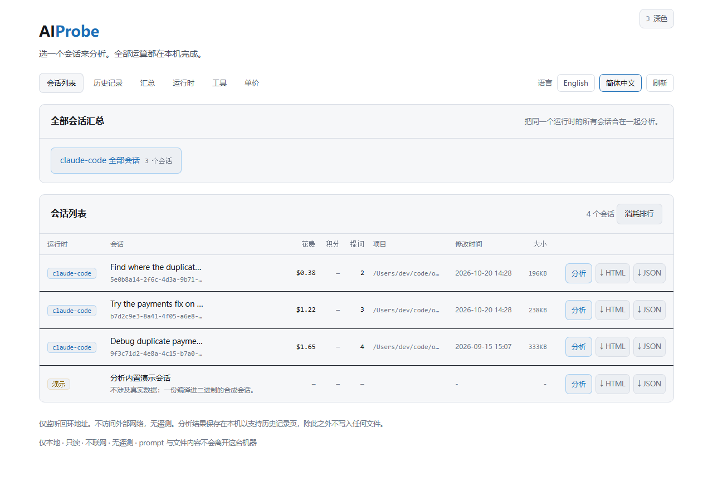

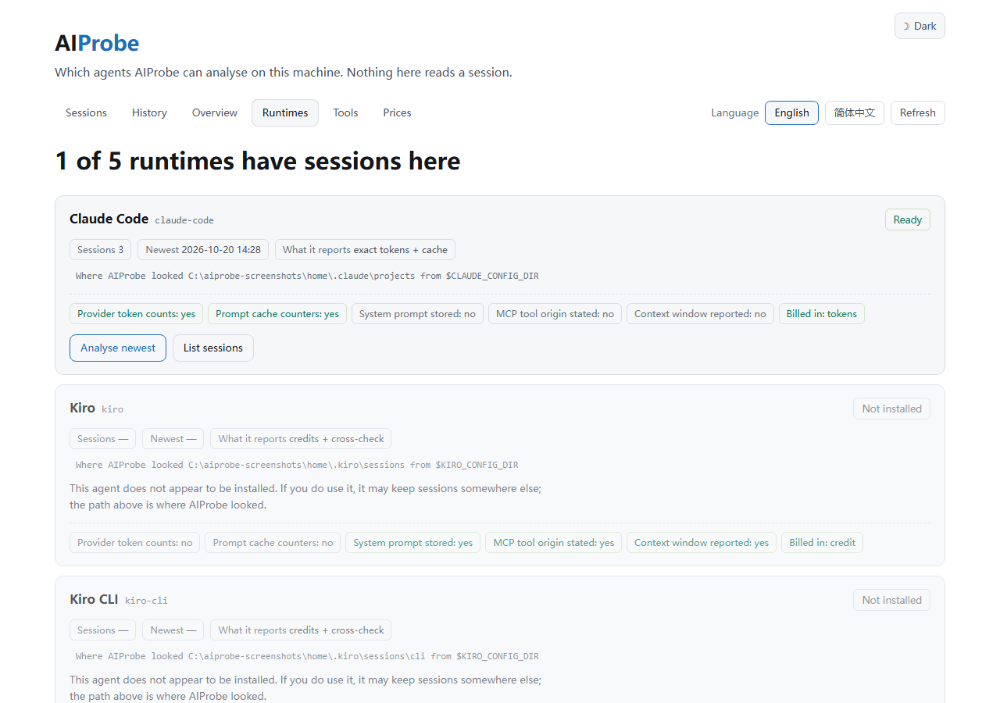

AIProbe 每一个页面都是双语的 —— 同样内容支持中英文切换：

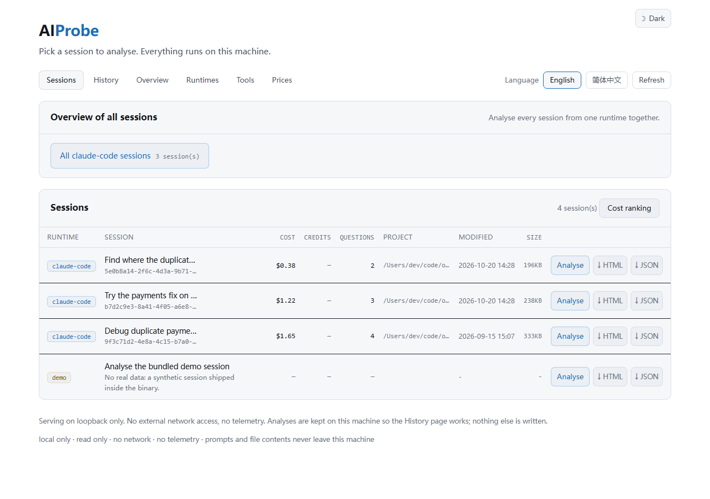

### Dashboard 深色主题

顶部 hero 显示的是浅色主题，同一份报告也支持深色主题，默认跟随读者系统偏好：

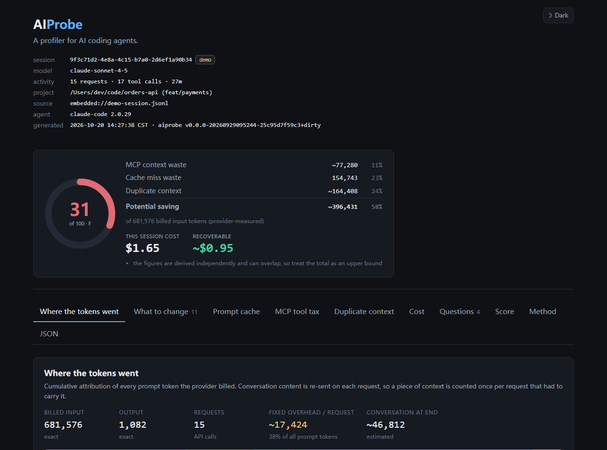

### 该改什么

对会话跑一遍确定性规则，每条 finding 都带上可回收 token 数、命中的证据，
以及具体的修复步骤。

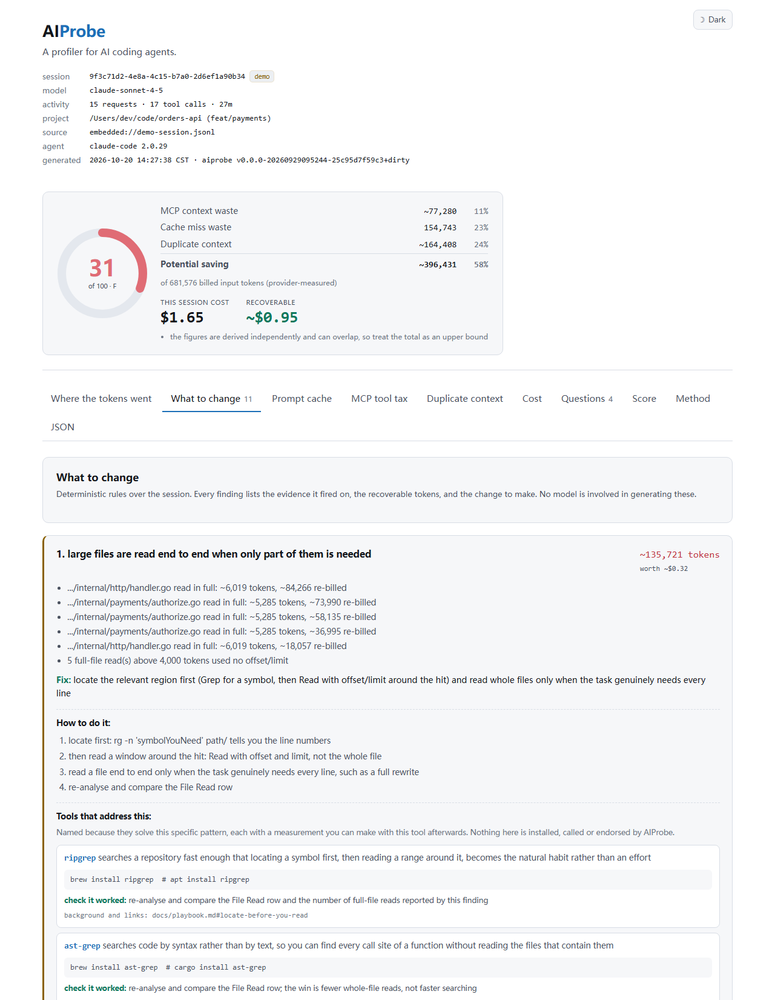

### Prompt 缓存

每轮的缓存命中率，以及 prefix drift 原因归因。哪些轮次前缀被打破，都标注了
明确原因，而不只是一个数字。

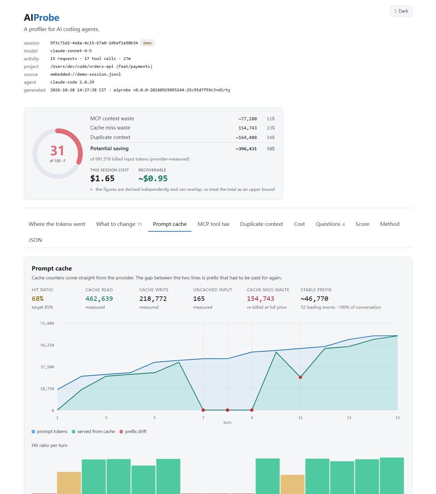

### MCP 工具税

每个 MCP server 往 prompt 里塞了多少工具、真正被调用了几个，以及那些
从未被调用的工具在整个会话里花掉了多少 token。

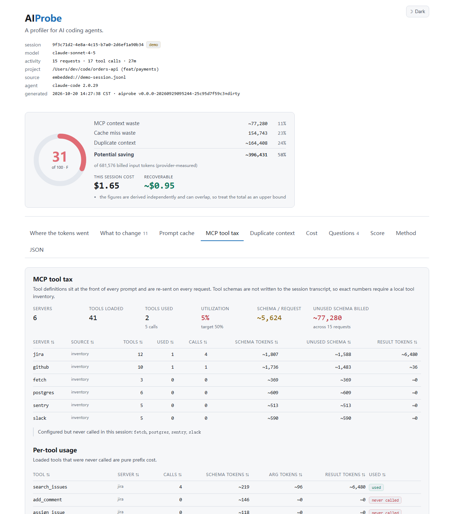

### 重复上下文

多次读取的文件、原样重复的 shell 输出、返回相同内容的工具结果 —— 每一行都
标出这一次的成本，以及它被后续每一次请求继续承担时的累计成本。

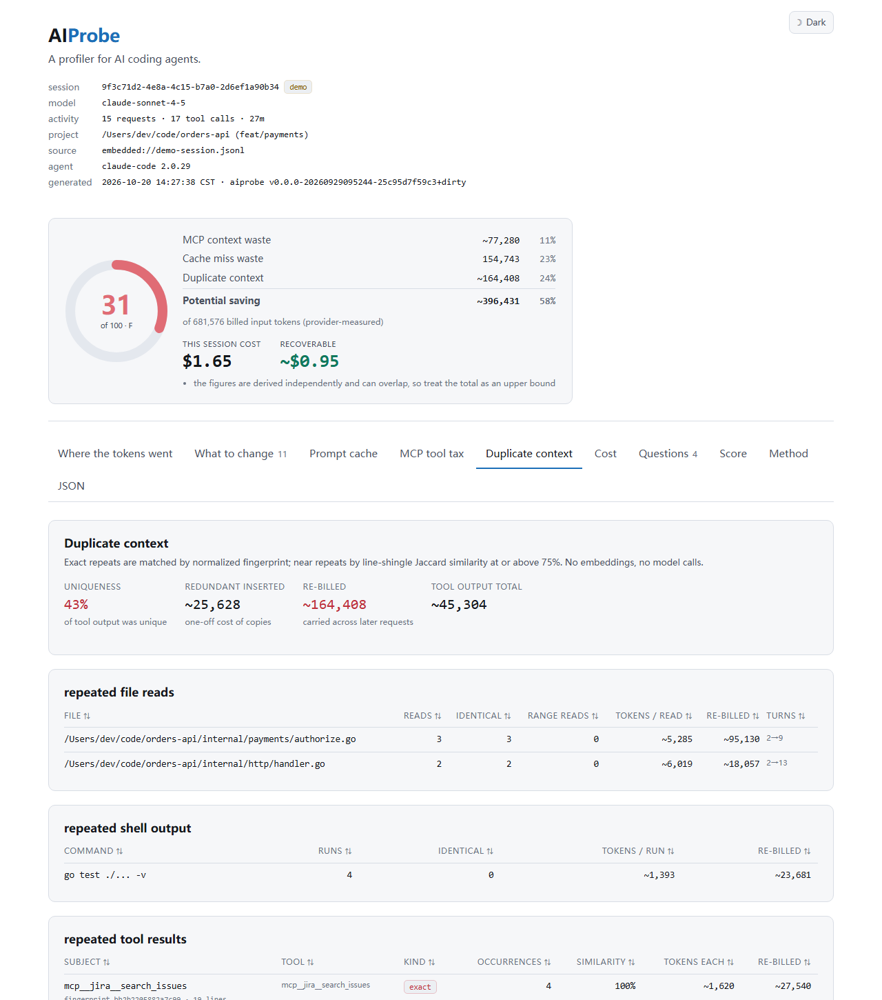

### 上下文效率分数

五个组件、一个 0–100 分。公式是确定性的，全部公开在
[docs/scoring.md](docs/scoring.md) —— 没有任何模型参与打分。

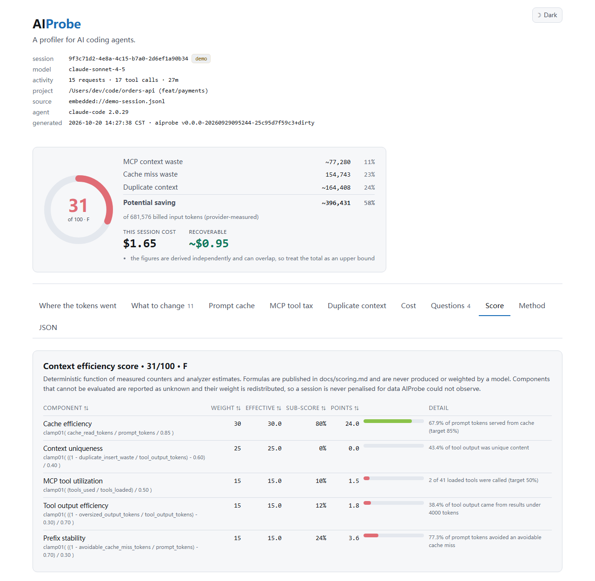

### 终端报告

如果你更喜欢 CLI，`aiprobe demo` 会在不开浏览器的前提下打印同样的八个章节：

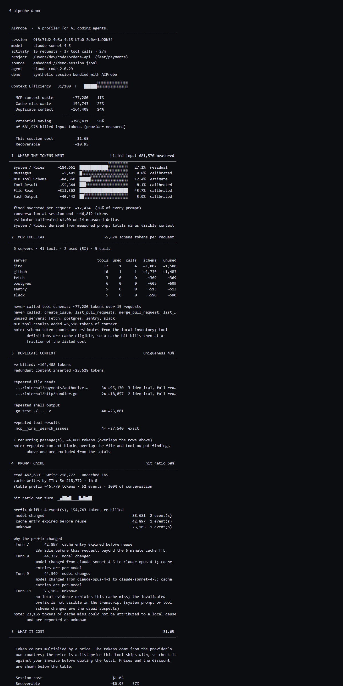

## 许可

MIT。见 [LICENSE](LICENSE)。
